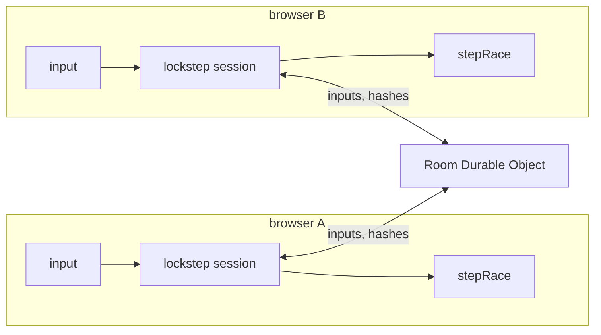

# RFC: Reef Rush online races with friends

Status, 2026-11-23: phases 1 to 4 are built for up to four racers (the game is now `games/rush-racers`; build plan `plans/rush-racers-online.md`): the room service in `apps/api`, the lockstep client in `src/net`, Friends on the title, the room, online races and results, departures handed to the AI, and the notices. Cut or changed from this RFC by that plan's "Decisions": no `hello` message (protocol version and build id ride on the WebSocket URL); no WebRTC; no rejoining a race, and a tab hidden mid-race leaves it for the title instead of reconnecting (5.8); no Easy online (a room on an Easy save starts on Normal); nothing from an online race is saved; no spectators, names or chat; more than four racers (5.10) is not built; the `?online=1` gate was dropped, so Friends ships on the title; the API deploys by hand with `pnpm deploy:api` before the site. The two-network real-device check stays with the owner.

Earlier status: phase 1 has landed on `deliver/reef-online` (lane plan: `plans/reef-online-deliver.md`): the world hash, several human slots with AI takeover, and an engine that follows a local racer. Its determinism guard holds: Chromium, the phone project and WebKit hash the top route equally. Draft written 2026-11-23, revised the same day after a devil's-advocate review against the code (section 12 lists what the review changed). The spikes in section 9 have not run. Section 11 lists decisions that need the owner.
Game: `games/reef-rush` (Phaser 4.2.1). Read `AGENTS.md`, `docs/repo-map.md`, `docs/architecture.md` ("Backend later, on Cloudflare") and `games/reef-rush/DESIGN.md` before starting.

## 1. Why

The owner asked for the easiest way to let people on different computers race each other in Reef Rush, preferably without a central server, using Cloudflare's free tier if one is needed. Their sizing, 2026-11-23: "We arent going to be having to handle anything crazy, probably 10 players at most, and these would almost always be friends sharing links with eachother, not strangers joining a public multiplayer room."

The owner confirmed on 2026-11-23 that this means up to ten racers in one race. That is two pieces of work with little overlap. The netcode carries ten players with three parameter changes (room size, message batching, cost; sections 5.5, 5.6). The game does not hold ten racers today: slot ids, start tiles, the roster draw, item rules by place, the race-end rule, the HUD and the results screen all assume four. Section 5.10 covers that, and the phases put it after four-player online play works.

## 2. Summary of the proposal

Every browser runs the same deterministic simulation and the browsers exchange only inputs. This is deterministic lockstep, the convention for fighting games, RTS games and emulator netplay, and Reef Rush's logic is close to meeting its requirements (section 5.1 lists the gaps).

Inputs travel through one small Cloudflare Durable Object per room, over WebSockets. The object creates the room, forwards each player's inputs to the others, and tells everyone when someone leaves. It never runs the game. It fits the free tier, with less room at ten racers than at four (section 5.6).

This differs from the first answer given in conversation, which recommended peer-to-peer WebRTC with the server used only for the handshake. Two browsers cannot find each other without a server in either design, so the room object exists either way. Having it also forward inputs removes WebRTC, STUN, TURN credentials and the roughly one pair in six that cannot connect directly, and it gives every peer the same ordered view of who left when, which is the hardest part of peer-to-peer lockstep to get right. The cost is a hard daily cap, which four-racer races stay far under and ten-racer evenings can approach (5.6). The session is written against a transport interface, so WebRTC can replace the relay later (section 6) without touching the session or the logic.

## 3. Who it is for and what they do

A player who wants to race someone they know: a kid and a parent on two laptops, friends on phones in different houses. They already have a way to send each other a link.

1. On the title, the player picks Friends, then Create room. The room screen shows a six-character code and a Copy link button.
2. The friend opens the link (`/games/reef-rush/?room=K7M2QX`), or picks Friends, Join and enters the code.
3. Each player picks a character. The host picks the course and the level and presses Start. Slots nobody took are AI rivals, so two people race two bots.
4. The race plays like a solo race. Results show everyone's place and time; Race again returns to the room.

Success means two people on different home networks finish a race with identical standings on both screens. Measures: the share of started races that end without a desync or a stall over 2 s, and input delay at or under 5 ticks (83 ms) for players in the same region.

## 4. Scope

In scope: private rooms joined by link or code, 2 to 4 humans for now (ten is designed in 5.10 and deferred), keyboard and touch, the existing courses and characters, Normal and Hard. A race has at least four racers: with two or three humans, AI rivals fill the field to four, as in solo play. With four or more humans there are no AI rivals at the start (5.10 says why). Solo play stays four racers and does not change.

Out of scope:

- Public matchmaking, accounts and typed names. Players are P1 to P10 and shown by character, so there is no text to moderate.
- Saving bests from online races. Bests are per course and level against the solo rival tuning.
- Easy level online. Easy's guide, steering assist and attack immunity are written for one human (`logic/guide.ts`, `DIFFICULTY.easy`). Question 4.
- Rejoining a race after leaving it. The racer is AI-driven for the rest of that race.
- Rollback netcode (section 10), spectators, chat, voice, same-keyboard play.
- Changes to `@arcade/shell`, `@arcade/input`, `@arcade/core` or `@arcade/save`. Changes that are needed outside the game, each in its own PR: `tools/arcade` and the biome rules (5.1, 5.7), and the `docs/architecture.md` row that says real-time multiplayer does not fit the free tier, which is true at scale and not at this size.

## 5. Design

Four parts, each behind a small interface.

| Part | Where | Depends on |
| --- | --- | --- |
| Human slots, world hash | `games/reef-rush/src/logic/` | nothing new |
| Lockstep session, wire codec | `games/reef-rush/src/net/` (new, no DOM) | logic, `@arcade/core`, zod |
| Transports | `games/reef-rush/src/net/transport/` | browser WebSocket |
| Room service | `apps/api/` (new Worker) | Cloudflare Workers, Durable Objects |

`src/net/` outside `transport/` is held to the logic rules: it joins the logic override in `biome.json` and a no-DOM tsconfig (today `tsconfig.logic.json` includes only `src/logic`). The session takes time as tick counts and elapsed milliseconds passed in, and bytes as arguments, so Vitest drives it without a browser.

### 5.1 What determinism has to hold

Lockstep works only if every peer computes the same state from the same inputs.

What holds today, checked in the code:

- `stepWorld` is one fixed step function with a documented tick order, stepped at the constant `TICK_DT`.
- Every random draw comes from seeded integer-only mulberry32 streams (`createRngs`, `RNG_SALTS`), one per AI slot plus `pickups`, `hazards` and `roster`. There is already an `ai.player` stream.
- Sorts are total with a `RACER_IDS` tiebreak (`race/standings.ts`, `racers.ts`); sets and maps are iterated in insertion order and filled only by race history; nothing in logic reads state the engine writes; effects and audio use their own rng.
- `input.vector` is digital: nine possible values, diagonals scaled by `Math.SQRT1_2` (`packages/input/src/index.ts`), and touch is a d-pad. Inputs are therefore already exact, with no floats to disagree on.

What does not hold yet, and is phase 1 work:

- `**` is used on floats in logic for squared distances (`hazards/squid-target.ts:13,48,59`, `hazards/squids.ts:115,205`, `ai/items.ts:182`, `abilities.ts:195`, `pickups/pearls.ts:45`). The language defines `**` as the same operation as `Math.pow`, which engines may approximate, so it carries the risk DESIGN.md bans `pow` for. Replace each with a multiplication.
- The ban on `Math.sin`, `cos`, `atan2`, `hypot`, `exp`, `pow` and `log` is a convention in DESIGN.md. `tools/biome/no-nondeterminism.grit` enforces only `Math.random`, `Date.now` and `new Date`. Extend the rule to those functions and to `**`, for `src/logic/**` and `src/net/**`.
- No test compares engines. `top-route.test.ts` runs in Node only and asserts a time margin, and the WebKit smoke asserts a place and a new best. Add `hashWorld` (5.4) and have smoke assert the top route's finish tick and final hash against one committed constant on Chromium and WebKit. That is the baseline the Firefox spike compares with.

What online play adds:

- Every peer must run the same simulation code. A build id is compared on joining a room: a hash of the source files under `src/logic`, `src/net` and `packages/core/src`, computed in the game's Vite config and injected as a define. Friends load the same deploy, so a mismatch only happens across a deploy and the fix is a reload.
- Race setup is identical everywhere because it comes from one `start` message: seed, course id, level, the slot each human holds, each human's character, and the input delay.
- `?stage=` debug stages are refused in an online race.
- Every 60 ticks peers compare a hash of their worlds, so a divergence is reported instead of silently producing two different races.

### 5.2 Human slots (logic)

Today one slot is privileged. The places that assume it:

| File | What it assumes | What the check really means |
| --- | --- | --- |
| `world.ts` | `stepWorld` takes one input; `racerSetup` gives only `player` a null `ai` and `PLAYER_PROFILE`; `trackGuide` and `assistedIntent` take the one input | who is driven by input |
| `race/standings.ts` | rivals-done timer, places and `checkRaceEnd` read `playerOf`; the result holds `playerPlace` | rule for humans |
| `modifiers.ts` | rivals' catch-up is measured against `playerOf(world)`; the player gets `playerCatchUpMul` | rule for humans |
| `difficulty-level.ts:160,179,189,194` | status length, `mayAttack`, clam weights, invulnerability | rule for humans |
| `difficulty-level.ts:184` | item aggression multiplier is 1 for the player | AI behaviour |
| `pickups/clams.ts:43` | the player gets 1 roll from a clam, rivals 2 | rule for humans |
| `ai/rival.ts:70` | the progress backstop skips the player | AI behaviour |
| `ai/items.ts:167` | attack choice reads the player's progress | rule for humans |
| `hazards/enemies/shark.ts:124` | Easy only | not online |

Changes:

- `WorldOptions.humans?: readonly RacerId[]`, default `['player']`, stored as `world.humans` and fixed for the race.
- Two helpers replace `id === 'player'`, chosen by the last column above. `isHuman(world, id)` is membership of `world.humans` and governs rules, so the rules applied to a racer never change mid-race, even after its player leaves. AI behaviour (the progress backstop, item aggression) is governed by `isRival(world, id)` in `src/logic/racers.ts`: true for a slot no person started in and for a human slot the AI took over (`racer.tookOverAt` set), so a taken-over racer behaves like any rival. A test bot driving a human slot is marked `Racer.testBot` (`src/logic/types.ts`, set by `race/seats.ts`) and is not a rival, so bot tests keep the player's rules. A blanket swap to `isHuman` would leave a taken-over racer without its stuck backstop.
- `WorldOptions.characters?: Partial<Record<RacerId, CharacterId>>` for online races. Slots without an entry are filled by `pickRivals` from the characters nobody picked, still drawn from the `roster` stream. `character` keeps working and means `{ player: character }`.
- `stepRace(world, inputs: Partial<Record<RacerId, TickInput>>, dt)` is the new step function. `stepWorld(world, input, dt)` stays as a wrapper passing `{ player: input }`.
- Who drives a racer stays what it is today: `racer.ai`. `intentFor` uses `rivalIntent` when `racer.ai` is set and ignores any input for that slot, which is what `playerBot`, `difficulty/bot-driver.ts` and `scripted-race.ts` rely on (they switch `player.ai` per tick). A racer with `ai === null` is driven by `inputs[id]`.
- Takeover: when a racer with `ai === null` has no entry in `inputs` on a tick, the world sets `racer.ai = createAiMemory(medium)`, gives it its character's rival profile and records `racer.tookOverAt = world.tick`. From then on it is a rival. The review confirmed the AI does not need to have run from the start: `createSwimPilot` replans on its first tick and its progress memory starts empty, and the slot's `ai.<slot>` stream is untouched until then on every peer alike. Takeover is deterministic as long as every peer omits the slot from the same tick on (5.5).
- Race end (as built in `src/logic/race/standings.ts`): the race ends when no active human (one the AI has not taken over) is left racing. Once every rival, taken-over humans included, has finished and at most one active human has not, that human gets `DNF_GRACE_TICKS` (600 ticks, 10 s) before the race ends without them. `RACE_LIMIT_TICKS` (5 minutes) ends any race. With one human this is today's rule.
- Catch-up: AI rivals measure theirs against the leading unfinished human, in one function, `catchUpTarget(world)`. `playerCatchUpMul` today gives a trailing player extra swim force relative to the field, which online would rubber-band one friend toward another. Both are tuning choices for question 5.
- Results: `world.race.result` gains a place per racer; `playerPlace` stays for solo callers.
- With `humans` at its default nothing may change. The guards are `top-route.test.ts`, `sanity/bars.test.ts`, the difficulty project and the new top-route hash constant, which is recorded before any other phase 1 change and must not move. (The `**` replacement is made first, on its own, so that if it shifts the hash the cause is known.)

Engine: `runtime.localRacer: RacerId` replaces the hard-coded `'player'` in the HUD, audio adapter, event effects, attack sounds, hints, threat views, dark view and camera (about 45 references in `src/engine`). In a solo race it is `'player'`. The slot ids keep their names; P1 to P10 map to `RACER_IDS` in join order.

### 5.3 The lockstep session

`src/net/session.ts`. One instance per peer per race. It decides when the world may step.

State:

- `simTick`: the last tick the world has stepped.
- `targetTick`: the tick the world should have reached by now. It is this peer's race clock.
- `inputTick`: the next tick this peer's input will be scheduled for.
- `pending`: button presses seen but not yet scheduled.
- `buffer[slot][tick]`: every input known, local and remote.
- `gone[slot]`: the first tick a departed slot has no input, once known.

`D` is the input delay in ticks, fixed for the race and equal on every peer.

Each logic step (the runtime's fixed 1/60 s step, the clock `tickRace` runs on today), the runtime calls `session.pump(localInput)`:

1. Merge `localInput` into `pending`: `move` and `kickHeld` take the newest value; `kick`, `use` and `cycle` are kept if set. These three are `justPressed` edges in `readPlayerInput`, so a press must survive a pump in which nothing is scheduled.
2. If `simTick === targetTick`, the world is on time: increment `targetTick`. Otherwise the peer is stalled and its clock stays where it is.
3. If `inputTick <= targetTick + D`, schedule `pending` for `inputTick`: store it in `buffer[local]`, send it, clear the edges in `pending`, increment `inputTick`. This runs at most once per pump, and not at all while stalled, so the buffer of unsent future inputs cannot grow.
4. If `simTick < targetTick` and `buffer` holds an input for tick `simTick + 1` from every slot that is human, not taken over and not gone by that tick, build the `inputs` record, call `stepRace`, and increment `simTick`.
5. If step 4 could not run, add this pump to the stall time.

Why `D` is real under this design: an input sampled when the clock reads `T` is scheduled for `T + D`, and the remote peer needs it when its own clock reads `T + D`. If the one-way trip through the relay takes `L`, the slack is `D` ticks minus `L`. A late packet eats slack before it causes a stall.

Stalling is the clock sync. A peer missing an input for the next tick does not step, and because its clock only advances when the world is on time, the stall shifts its whole schedule later by that amount, which is exactly the slack it was short. Peers that started a few tens of milliseconds apart settle after one early stall. No peer ever steps a tick without everyone's inputs, so a bad connection costs smoothness and never correctness. There is no multi-tick catch-up: a peer never needs to run faster than real time, because everyone else waits for its inputs.

The first ticks: `inputTick` starts at `D + 1`. Ticks 1 to `D` have no scheduled input from anyone and are stepped with idle inputs for every human. They fall inside the 180-tick countdown, when racers cannot move.

Choosing `D`: the host computes it at Start from the room's ping readings. `D = clamp(ceil(worstOneWayMs / 16.7) + 2, 3, 12)`, where `worstOneWayMs` is the largest relay path between any two racing peers (the sum of their two measured halves) and the 2 ticks are jitter margin. The room screen shows each peer's ping and warns above 100 ms, where `D` passes 8 and a press takes over 130 ms to act. Above 170 ms the cap is reached and the race will stall often; the room still allows it, since friends may prefer a rough race to none.

Sending: one `inputs` message per scheduled tick, so 60 a second per peer. The relay is reliable and ordered, so nothing is sent twice. Batching two ticks per message would halve the request cost in 5.6 at the price of one more tick of delay, and is not needed at this size.

Stall handling: the session reports stall time in milliseconds from elapsed time the runtime passes in, never from a pump count. Past 500 ms the race view shows "waiting for P2". Past 5 s it asks the room to remove the peer it is waiting on (5.5). In test mode the kick is off: `advance(n)` runs `n` pumps inside one synchronous call during which no WebSocket message can arrive, so any count-based limit would kick the other page.

The runtime: `engine/runtime.ts` `tickRace` calls `stepWorld(world, readPlayerInput(), dt)` today. Online it calls `session.pump(readPlayerInput())` and the session calls `stepRace`. Hints, audio progress and the results countdown run once per stepped tick, not once per pump. Rendering already draws from world state each frame.

### 5.4 Wire protocol

Built note, 2026-11-23: `hashWorld` leaves out what is fixed before the first tick (`level`, and `humans`, which slots people race in). The race-start message must therefore carry `humans` along with the seed, course, difficulty and characters, and every peer must build its world from that message alone, because the hash will not show a disagreement about them.

Control messages are JSON text, validated with Zod on receipt. `inputs` and `hash` are binary, since they are nearly all the traffic.

| Message | Direction | Encoding | Carries |
| --- | --- | --- | --- |
| `hello` | peer to room | JSON | protocol version, build id |
| `welcome` | room to peer | JSON | your peer id, the peers present, the host's peer id, room phase |
| `joined`, `left` | room to all | JSON | peer id |
| `lobby` | peer to all | JSON | character pick, measured half-ping, `ready` (false while the tab is hidden); host only: course, level |
| `start` | host to all | JSON | seed, course id, level, `{ peerId: slot }`, `{ slot: character }`, `D` |
| `inputs` | peer to all | binary | tick (uint32), then 2 bytes |
| `hash` | peer to all | binary | tick (uint32), hash (uint32) |
| `kick` | peer to room | JSON | the peer id it has been waiting on |
| `end` | peer to all | JSON | sent once a peer's race is over, with its final hash |

An input is 2 bytes. The first holds `move` as two 2-bit fields (left, none, right; up, none, down), and the decoder rebuilds exactly the nine values `input.vector` produces, diagonals included. The second holds `kick`, `kickHeld`, `use`, and `cycle` as two bits. `useSlot` is AI-only and never sent. If an analog stick is ever added to `@arcade/input`, `move` needs quantising at that point, and the local simulation must then consume the decoded value. The room prefixes each forwarded binary message with the sender's peer id (one byte); peers map peer id to slot from `start`. A peer ignores `inputs` from a slot after that slot's `left`.

Ping uses the WebSocket auto-response (`setWebSocketAutoResponse` with a fixed string pair), which the runtime answers without waking the object, so an idle lobby hibernates. The peer times the round trip and reports half of it in `lobby`.

`hashWorld(world)` (new, `logic/hash.ts`) is a 32-bit FNV-1a over the tick, each racer's body, status counters, item slots, dash meter, finish and `tookOverAt`, AI memory, ability state, every rng stream's `state()`, clam timers, the broken-coral set, and the positions of loose items, squids, bubbles, inks and enemies. Floats are hashed by bit pattern through a `Float64Array` view. Each peer sends it for ticks that are multiples of 60. Peers run a few ticks apart, so a remote hash can arrive before the local world reaches that tick: received hashes are kept until then, and local ones for the last few seconds. A mismatch emits `net.desync` with the tick and both hashes, and ends the race on that peer with a "the race fell out of sync" screen. V1 does not resync.

### 5.5 The room service

A new Worker in `apps/api` with one Durable Object class, `Room`, SQLite-backed (the only kind the free plan allows), using the WebSocket Hibernation API.

Routes:

- `POST /api/rooms` picks a code (six characters from a 31-character alphabet with no 0, O, 1, I or L) and returns it. The object id is `idFromName(code)`; the handler has the object claim the code and retries on a collision.
- `GET /api/rooms/<code>` with `Upgrade: websocket` joins. The Worker checks `Origin` against the site origin, `localhost`, `127.0.0.1` (tests and smoke use it) and the preview domain.
- Refusals never use an HTTP error status on the upgrade. The room accepts the socket and closes it with an application close code (room full, version mismatch, unknown room, unavailable). A 4xx on a WebSocket upgrade logs a console error in Chrome, and the test fixture fails any test with a console error.

What the object keeps, and where. Anything that must survive hibernation lives in each socket's attachment (`serializeAttachment`): peer id, join sequence number, protocol version, build id, whether it is in the current race, whether it has sent `end`, and a `departed` flag. The object rebuilds its view from `ctx.getWebSockets()` on every wake. Nothing is written to storage on the message path.

What it does:

- Accepts at most 4 sockets (10 if section 5.10 is ever built). The host is the connected peer with the lowest join sequence number, so a player who leaves and returns does not take the host role back.
- Compares a joiner's protocol version and build id with the attachments of the sockets already present, and closes a mismatch with the version close code. The client shows "reload to update".
- Forwards `lobby`, `start`, `inputs`, `hash` and `end` to the other sockets, unchanged apart from the sender prefix. Each send is wrapped in its own try/catch, so a socket that is closing cannot make the others miss a message.
- Race phase is derived: the room is racing while any connected socket is in the current race and has not sent `end`. A peer that left never sends `end`, so it must not be counted. A peer that joins mid-race gets `welcome` with phase `racing` and waits on the room screen.
- On close or error: sets the socket's `departed` flag, then broadcasts `left` once (close and error can both fire). Any message that still arrives from a departed socket is dropped.
- On `kick`: it closes the named socket only if it has itself received nothing from that socket for 5 s. The object sees every message, so it can check the claim. Without the check, a peer whose own downlink stalled would see everyone as silent and kick the healthy players. A kicked socket is treated as a close.
- Limits: 80 messages a second per socket, 1 kB per message, close on violation. An alarm, set only on join, `start` and the last `end`, closes a room idle for an hour.

Why the room makes leaving simple. Each peer's messages reach the object over one ordered connection and are forwarded in the order received, then `left` follows. So every remaining peer sees the same sequence from a departing peer: its inputs up to some tick `K`, then `left`. Each sets `gone[slot] = K + 1` and omits the slot from `stepRace` from that tick, which triggers the takeover in 5.2 on the same tick everywhere. A peer that had only stepped to an earlier tick keeps using the real inputs it holds until `K`. A peer-to-peer mesh lacks this property, because peers can hold different numbers of the departed peer's inputs.

When a peer counts as gone:

- Its socket closes (tab closed, network lost).
- Its tab is hidden during a race: the client closes the socket itself (5.8).
- It is connected but silent for 5 s: a waiting peer sends `kick` and the object verifies it.
- If a peer's own socket closes, it is out: it shows "connection lost" and returns to the title, and the others carry on with its racer AI-driven.
- The host leaving mid-race changes nothing, since the host has no role after `start`.

Deploys. Deploying the API Worker restarts its Durable Objects and drops every socket, which ends every race in progress. With a handful of friends and an API that rarely changes this is acceptable, and it is why the API deploys separately from the site (5.7).

### 5.6 Cost on the free tier

Figures from Cloudflare's pricing pages as read on 2026-11-23: 100,000 Durable Object requests a day and 13,000 GB-s of duration a day on the free plan; incoming WebSocket messages count 20 to 1 against requests; an object that is idle and able to hibernate accrues no duration. The 20 to 1 ratio comes from a 2024 release note and needs confirming on the current page (section 9).

A race lasts about 115 s including the countdown. Each player sends 60 `inputs` messages and one `hash` a second, about 7,000 messages, which is 350 requests at 20 to 1.

| Race | Messages per tick batch | Requests | Races a day under the cap |
| --- | --- | --- | --- |
| 2 players | 1 tick | about 700 | 140 |
| 4 players | 1 tick | about 1,400 | 70 |
| 10 players | 1 tick | about 3,500 | 28 |
| 10 players | 2 ticks | about 1,800 | 55 |
| 10 players | 3 ticks | about 1,250 | 80 |

Duration is about 15 GB-s a race whatever the field, so that cap allows about 870 races and never binds. Lobbies cost a handful of messages and hibernate in between.

Ten players make the request cap matter. Unbatched, one evening of ten friends (28 races is under an hour of racing) can spend the whole account's day. So the batch size is a field in `start`: 1 tick for fields up to four, 2 ticks for larger fields, at the price of one more tick of input delay. With batching, 55 ten-player races is close to two hours of continuous play.

The caps are account-wide, fail hard, and reset at 00:00 UTC. When the room service refuses or is unreachable, the Friends screen says online play is unavailable and solo play is untouched. If ten-player evenings become regular, the $5 Workers Paid plan removes the cap for about 30 cents of usage a month at that volume, and the WebRTC transport removes the per-message cost entirely.

The object's work also grows with the square of the field: ten peers at 30 messages a second is 300 incoming and 2,700 outgoing messages a second. Outgoing messages are not billed, and forwarding is a few microseconds each, but it is unmeasured and is a spike item.

`docs/architecture.md` currently says real-time multiplayer on Durable Objects "doesn't fit" and needs a paid plan from day one. Its arithmetic (about 28 player-hours a day at 20 messages a second) agrees with the table above; the conclusion differs only because this feature is sized for ten friends. Phase 3 updates that row to say so.

### 5.7 Hosting, routing, deploys and local development

- `apps/api/wrangler.jsonc` declares the Worker, the `Room` binding and a migration with `new_sqlite_classes: ["Room"]`.
- Routing `/api/*`: `docs/architecture.md` plans a service binding from the assets Worker with `run_worker_first: ["/api/*"]`, which gives the assets Worker a small forwarding script. A zone route on the API Worker would avoid that script, but the review's reading is that under multi-config `wrangler dev` only the first Worker is served on the port and the others are reachable only through service bindings, and that a route may not take precedence over a Custom Domain on the same hostname. If the spike confirms either, the service binding is the only option that behaves the same locally, in smoke and in production, and is the one to use.
- Deploys: `apps/api` gets its own Workers Builds connection that deploys from `main` only, with build watch paths limited to `apps/api/**`. It must not be a second `wrangler deploy` inside `cf:build`, because Workers Builds runs that command on PR branches too and would deploy the production API from every PR.
- Local development: the `/api` proxy (with WebSocket upgrade) to a `wrangler dev` of `apps/api` goes in the game's `vite.config.ts`. The game's `playwright.config.ts` adds that `wrangler dev` as a second `webServer`, so the two-page test runs under `arcade test` and not only under smoke.
- `tools/arcade` (own PR): `arcade smoke` starts both Workers; `arcade check` and CI typecheck and test `apps/api`, which they do not know about today. `docs/repo-map.md` gains rows for `apps/api`.

### 5.8 Pause, background tabs and phones

The shell puts the game loop to sleep on `visibilitychange` to hidden (`packages/shell/src/index.ts:251`, `game.ts:147`). A sleeping peer would stall everyone, so hiding the tab during an online race means leaving it: a `visibilitychange` listener in the game's net layer closes the socket, the others get `left`, and the returning player sees "you left the race", reconnects to the room with a new socket, and waits there for the race to end. The shell does not change.

In the lobby the same sleep matters differently. A friend who opens the link and switches back to the chat app is in the room with a sleeping game. If the host started then, that peer would never pump and would be kicked five seconds in. So each peer reports `ready: false` in `lobby` while hidden, the room screen shows that player as away, and Start includes only ready peers. An away player joins the next race.

On a phone this means switching apps or pulling down notifications ends that player's race. That is harsh for a child, and the alternative, a grace period in which everyone stalls, is worse for the others. Question 6.

A device rendering at 30 frames a second still runs 60 logic steps a second from the fixed-step accumulator, so slow rendering does not slow the others. A device that cannot simulate 60 ticks a second slows the race for everyone, by design.

### 5.9 Screens and runtime

- `friends` scene: Create room, Join with code (six cells, driven by the d-pad and by typing), Back.
- `room` scene: the code and Copy link, ten slots showing P1 to P10 with each pick, ping and away state, the character grid from `select` reused, course and level for the host, Start (host, enabled with two or more ready humans), and a status line for "waiting for host", "race in progress", "reload to update" and "online play unavailable".
- Title gains a Friends button. `?room=<code>` opens `room` after boot.
- Race: unchanged apart from `localRacer`, the "waiting for P2" label and small P-number tags over other humans' racers.
- Results: standings as today with P-numbers on human rows; Race again returns to `room`; Title leaves the room.
- `debugSummary()` gains `net`: `{ room, peers, localRacer, simTick, targetTick, inputDelay, stalledMs }`.
- The race seed comes from the host (`crypto.getRandomValues`, in the engine). Online races do not increment the save's race count and write nothing to the save.
- DESIGN.md gains the scenes, the launch parameter and an "Online" section.

### 5.10 Ten racers in one race

This is game work more than network work, and most of it is design and tuning that needs measuring with bots before anyone commits to numbers.

What lockstep does at ten. The race advances at the pace of the slowest connection, because no peer steps a tick without everyone's inputs. With two players that is one link that can hiccup; with ten it is ten, so stalls are several times more frequent, and `D` is set by the worst pair in the room. It stays correct, and RTS games ran eight players this way for years, but ten is the top of the range where plain lockstep is comfortable. The 5 s kick and AI takeover keep one bad connection from holding the rest for long. If stalls are the complaint in ten-player playtests, rollback (section 10) is the fix that addresses it, and it is a large one.

What the code assumes today, and what changes:

| Assumption | Where | Change |
| --- | --- | --- |
| Four slot ids | `RacerId`, `RACER_IDS`, `RNG_SALTS` (`ai.<id>`), per-id palettes in `engine/art/palettes.ts`, `debug-stage.ts` | `RACER_IDS` grows to ten slots (the four names kept, six added) with a salt each. A race uses the first `field` of them: `WorldOptions.field`, default 4. New salts create new streams and leave the existing ones alone, so a four-racer race is bit-identical to today |
| Four start tiles | `level/parse.ts` `requireAllStarts`, start glyphs `1`-`4` | Start glyphs for ten slots; a course declares how many it has and `createWorld` rejects a field larger than that. Sunlit Shallows needs six more start tiles in its start bay, without moving any existing tile (scenarios pin columns 0-94) |
| Eight characters, drawn without repeats | `pickRivals` returns three of the other seven | Ten racers cannot all be different. Two humans may pick the same character; a small P-number tag over each racer tells them apart. Question 1 |
| Places run 1 to 4 | `clams.ts` `LAST_PLACE`, `CLAM.undertowMinPlace: 3`, `TRAILING_SQUID.fromPlace`, DESIGN's "3rd or 4th" rules | Place rules become relative to the field: weights interpolate from first to last of `field`, and "trailing" means the back half. At field 4 they must give exactly today's numbers |
| Item supply for four | Clams sit in pairs and stay shut 1.5 s | A pack of ten finds most clams shut. Shut time or clam count has to scale with the field; measure item uses per racer per race against today's 5 to 10 |
| Race ends 10 s after the third rival finishes | `race/standings.ts` | The timer starts when all but one racer has finished, and no later than 30 s after the winner, so nine people are not held by one straggler |
| Racers are solid | `race/collide.ts` `separateRacers`, bumps feed Onyx's and Baron's abilities and the Puffer | Ten solid racers through a two-tile coral gate or the urchin tube may jam. Measure first; the options are solid as now, or racers pass through each other in large fields (`racerCollision: 'ghost'` already exists on the medium) at the cost of the bump abilities. Question 2 |
| Abilities tuned for three opponents | Rook's Frenzy fires when any racer within 5 tiles is hit; Undertow pulls every racer ahead | In a pack of ten Frenzy may be on most of the race and one Undertow hits up to nine racers. Measure and retune per field size |
| HUD and results laid out for four | progress strip heads, place readout, `scenes/results.ts` podium and rows, `UI.md` | Ten heads on the strip, places to 10th, ten standings rows on a 320 by 180 base, and a ten-slot room screen. All need a `UI.md` pass |
| Performance measured at four | 6 racer pairs to separate, 3 AI pilots | 45 pairs and up to ten sprites with effects. Likely fine; measure a ten-racer race on a phone |

AI rivals in large fields. The rival AI, its catch-up and its item aggression are tuned and measured for three rivals chasing one player (the whole `difficulty` test project). Rather than retune them for nine, a race with four or more humans starts with no AI. AI still appears in a large field when a player leaves and is taken over, which is rare enough to accept untuned.

How to measure before deciding. The bot harness (`difficulty/race-bots.ts`, `bot-driver.ts`) already runs whole races headlessly. Once `field` is data, a spike runs ten expert bots through Sunlit Shallows over 30 seeds and reports finish spread, time spent stuck at each chokepoint, item uses per racer, and how often Frenzy is active. Those numbers answer the collision, item-supply and ability questions.

Solo play and four-racer online races must not change. Every rule above is written so that `field: 4` reproduces today's values exactly, and the phase 1 hash constant guards it.

## 6. WebRTC later

Build it only if relay latency is the complaint in playtests or usage outgrows the free caps. It replaces `transport/` and nothing else. The shape: the room object stays for joining and forwards the WebRTC handshake; each guest opens one connection to the host, and the host forwards inputs in the order received, taking the role the room object has in 5.5; ICE uses Cloudflare's free STUN, and TURN (1,000 GB a month free) for pairs that cannot connect, with credentials minted by the Worker.

Two things would need real design then. First, input traffic belongs on an unordered, unreliable channel with each message repeating the last several ticks, and on that channel the ordering argument in 5.5 no longer holds by itself: when a guest drops, the host must send a reliable `gone` message carrying that guest's final inputs and the takeover tick. Second, the host leaving ends the race for everyone unless host migration is built. A full mesh would cut a hop of latency and needs an agreement step on every departure; it is not worth it at this size.

## 7. Tests

- Logic (Vitest): two human slots driven by two scripted input streams; a human slot whose input stops is taken over on that tick, gets the stuck backstop and rival item aggression, and two worlds given the same stop tick stay hash-equal; `playerBot` and the bot drivers still ignore input; the race-end rule with several humans and with one taken over; humans get one clam roll; `hashWorld` is equal for equal histories and differs after one changed input.
- Cross-engine: smoke asserts the top route's finish tick and final hash against one committed constant on Chromium and WebKit.
- Lint: a fixture file using `Math.pow` and `**` in `src/logic` fails the extended rule.
- Codec (Vitest): every `Intent` the input layer can produce round-trips to identical values; malformed binary and JSON are rejected.
- Session (Vitest, an in-memory transport delivering in order after a scripted delay): two, four and ten sessions end hash-equal at delays from 0 to 10 ticks, with jitter, and with one peer pumping at half speed; a late input stalls, shifts that peer's clock and resumes; a fire pressed during a stall is delivered on the next scheduled tick; `left` after tick `K` takes the slot over at `K + 1` on every session, including one that had only stepped to `K - 5`; 5 s of stall asks for a kick and less does not; a forced divergence reports `net.desync`; a remote hash that arrives early is compared when the tick is reached.
- Room service (Worker tests): join, peer ids and host by join order, forwarding with the sender prefix, one `left` per departure, messages after `left` dropped, a send failure to one socket not affecting the others, `kick` honoured only for a silent socket, the ten-socket cap, limits, close codes instead of HTTP errors, the origin check, version mismatch after a hibernation, race phase clearing when a racing peer leaves without `end`. Whether `@cloudflare/vitest-pool-workers` runs on Vitest 5 is a spike item.
- Browser (Playwright): two browser contexts join one room, pick characters and race a short unlisted test course to the finish, asserting equal standings and equal final hashes; a second test closes one page mid-race and asserts the other finishes with that racer taken over. The `game` fixture checks one page, so the test builds a second `GameDriver` for the second context and asserts its `problems()` itself. Pages are advanced in small turns, waiting on `debugSummary().net.simTick`.
- A real-device check, two networks, one phone on mobile data, before the Friends button ships.

Each new test is watched failing once, per `AGENTS.md`.

## 8. Phases

Each phase lands on its own and leaves solo play unchanged.

1. Determinism and human slots. In order: `hashWorld` and the cross-engine smoke constant; `**` replaced and the lint rule extended; then `world.humans`, `stepRace`, takeover and `localRacer` (5.1, 5.2). No networking, nothing visible to players.
2. `src/net/`: codec, session, in-memory transport and their tests (5.3, 5.4), with the biome and tsconfig coverage for the folder.
3. `apps/api` with the `Room` object, routing, deploy connection and local wiring (5.5, 5.7), the WebSocket transport, the `friends` and `room` scenes, two players, reachable only with `?online=1`. The architecture doc row is updated here.
4. Three and four players, departures and `kick`, hidden tabs and the away state, the unavailable and version screens, the real-device check. Then the Friends button ships on the title, with rooms capped at four.
Deferred (owner, 2026-11-23: "start with 4, dont build the 10. We'll see if more than 4 ever goin, and if so then we can expand it"). Nothing below is built, including the ten-wide slot list, until more than four people want to race at once:

5. Ten-racer measurement (5.10): start tiles for ten on Sunlit Shallows, the ten-bot spike, and its report. The owner decides collision, item supply and ability tuning from the numbers.
6. Ten racers: field-relative place rules, the race-end rule, clam supply, the chosen collision mode, HUD, results and room layouts for ten, two-tick batching, the room cap raised to ten, a ten-session lockstep test and a phone performance check.

Phases 1 to 4 are the netcode and are worth shipping at four racers first: they prove lockstep on real networks with the game's existing balance, and nothing in them is redone for ten. Phases 5 and 6 are mostly game design.

## 9. Spikes before phase 3

- Run the assets Worker and the API Worker under one `wrangler dev` and settle routing (5.7). Confirm PR preview URLs still work for the static site.
- Firefox replays the top route to the committed finish tick and hash.
- Confirm on the current Cloudflare pricing page: 20 to 1 billing for incoming WebSocket messages, 13,000 GB-s a day of duration on the free plan, and whether a message from a socket can still be delivered after that socket's close has been handled.
- Measure relay latency between two real networks through a deployed room, to check that `D` lands at 5 or under for players in one region.
- Check `@cloudflare/vitest-pool-workers` against Vitest 5.
- Load a deployed room with ten sockets sending 30 messages a second each for two minutes, and read the request and duration it was billed.

## 10. Risks

| Risk | Likelihood | Handling |
| --- | --- | --- |
| Removing the single-player assumption changes solo behaviour | Medium | `stepWorld` kept as a wrapper; dispatch stays on `racer.ai`; top route, bars and the hash constant must not move |
| Logic differs between engines in a way nothing checks today | Medium | `**` removed; lint rule extended; hash constant asserted on Chromium and WebKit; Firefox spike; hash compared every 60 ticks in play |
| Relay latency makes input delay uncomfortable | Medium | Latency spike before phase 3; ping and a warning in the room; WebRTC as the next step |
| TCP head-of-line blocking on lossy Wi-Fi causes visible stalls | Medium | Stalls are correct, only unsmooth; 2 ticks of margin in `D`; WebRTC's lossy channel if it matters |
| An API deploy ends races in progress | Certain when it happens | API deploys separately and rarely; players see "connection lost" and race again |
| An account-wide free cap is spent by another feature | Low | Unavailable state; solo play unaffected |
| Ten-player evenings spend the daily request cap | Medium | Two-tick batching (55 races a day); Workers Paid at about $5 a month; WebRTC |
| Ten connections stall far more often than two | High | `D` from the worst pair; 5 s kick and takeover; rollback if playtests demand it |
| The course and items do not work with ten racers | High until measured | Phase 5 measures with ten bots before any tuning is committed |
| A stranger guesses a room code | Low | 887 million codes against a handful of live rooms; rooms expire; ten-socket cap |
| Catch-up rules tuned for one human feel wrong with several | Medium | Question 5; measure with the race bots standing in for humans before phase 4 |
| Hidden-tab-means-leaving frustrates phone players | Medium | Question 6; revisit after the real-device check |

Rollback netcode would remove input delay by predicting remote inputs and resimulating on a miss. It needs a snapshot and restore for `World`, which is mutated in place and holds sets, rng closures and an event sink, and it needs audio and effects to ignore events from resimulated ticks. Consider it only if input delay is still the complaint after WebRTC.

Cheating: every peer simulates everything, so a modified client can send inhuman inputs but cannot change another racer's state without causing a desync. That is acceptable among friends.

## 11. Open questions for the owner

1. With ten racers and eight characters, may two players pick the same character (proposed, told apart by P-number tags), or should the roster grow first?
2. In large fields, do racers stay solid, with bumps and possible jams at chokepoints, or pass through each other? Proposed: decide after the phase 5 bot measurement.
3. Relay through the room object first, with WebRTC as a later swap (proposed), or peer-to-peer from the start because no game traffic should touch a server?
4. Normal and Hard only online (proposed), or is Easy needed for young players racing a parent?
5. Catch-up online: should AI rivals chase the leading human (proposed), and should a trailing human keep the swim-force boost that would pull them toward a friend who is ahead?
6. Hiding the tab leaves the race (proposed). Is that acceptable on phones?

Decided:

- 2026-11-23: "10 players at most" means up to ten racers in one race.
- 2026-11-23: four-racer online play ships first (phases 1 to 4). Ten racers are deferred entirely, plumbing included, until more than four people want to race at once.

## 12. What the review changed

A devil's-advocate pass checked the first draft against the code. It agreed with relay-first and confirmed that AI takeover works with the AI as written. It found these errors, all corrected above:

- The session algorithm never applied `D`: it scheduled one input per pump but stepped as far as inputs allowed, so there was no jitter margin, and presses made during a stall were dropped. 5.3 now has a per-peer race clock and keeps pending presses.
- The kick rule let a peer with a stalled downlink eject healthy players, and would have fired inside test mode's `advance()`. The room now verifies silence itself, the limit is 5 s of real time, and it is off in test mode.
- `stepRace` dispatching on "has an input" would have broken `playerBot` and the bot drivers. Dispatch stays on `racer.ai`.
- A blanket `isHuman` swap would have left taken-over racers without AI-only behaviour and made the race wait on them. The checks are split and race end ignores taken-over humans.
- The draft cited "race fingerprints" and Chromium/WebKit replay equality as existing guards. Neither exists. `**` on floats in logic is an unguarded `pow`. Phase 1 now builds the guard first.
- The room kept the version pair and race phase in memory that hibernation loses, and a failed send could leave a gap in one peer's stream. State moved to socket attachments; sends are isolated.
- A second `wrangler deploy` in the build command would have deployed the production API from PR branches.
- The build id as "a hash of the built chunk injected into that chunk" was circular.
- Input is digital, so the int8 stick quantising was unnecessary. Two-tick batching and the full WebRTC specification were more than this size needs and were cut back.
- "No `packages/` change" was too broad: the shell is untouched, but tooling, lint rules and test wiring change.
